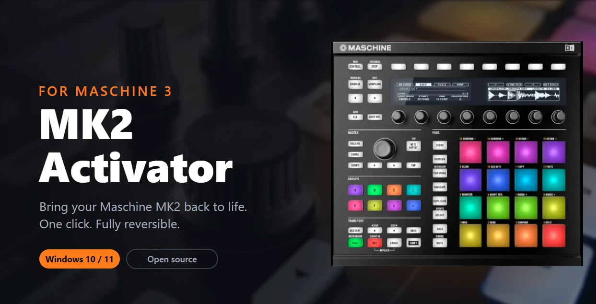

# Maschine MK2 Works in Maschine 3



Makes your **Maschine MK2** work in the **Maschine 3** software again (Windows). Download **MK2 Activator**, click one button, and play.

> [!CAUTION]
> **!!! MASCHINE JAM WILL STOP WORKING IN MASCHINE 3 WHILE THE MK2 IS ENABLED !!!**
>
> Use **Restore original** in the Activator to get the Jam back.

$${\color{red}\textbf{!!! MASCHINE JAM WILL STOP WORKING IN MASCHINE 3 WHILE THE MK2 IS ENABLED !!!}}$$

> [!WARNING]
> This is an unofficial project, not affiliated with or endorsed by Native Instruments. Use it at your own risk. It does not touch licensing or activation: you need your own licensed copy of Maschine 3.

## Requirements

- Windows 10 or 11 (64-bit)
- Maschine 3 installed and activated with Native Access
- Maschine MK2 driver installed (*Maschine Controller MK2 Driver*)

**Supported Maschine 3 versions:** 3.6.0 and 3.7.1 are analyzed and tested. Other 3.x builds are patched only if the Activator finds the exact code it expects; otherwise it refuses and nothing is changed.

## How to use

1. Download `MK2 Activator.exe` from the [Releases](../../releases) page.
2. Close Maschine 3.
3. Double-click `MK2 Activator.exe` and click **Yes** when Windows asks for permission.
4. Click **Enable MK2**.
5. Connect the MK2 and open Maschine 3.

To undo it, open the Activator again and click **Restore original**. Repairing Maschine 3 in Native Access works too.

**After every Maschine 3 update from Native Access, run the Activator again.**

### Windows says the app is dangerous

The Activator is not digitally signed, so Windows SmartScreen shows "Unknown publisher". Click **More info** → **Run anyway**. The source code is in this repository.

Every release `.exe` is built by [GitHub Actions](../../actions) from the code in this repository, and each release includes a `SHA256.txt` so you can check your download:

```powershell
Get-FileHash "MK2 Activator.exe" -Algorithm SHA256
```

## Build it yourself

```bash
python -m pip install pyinstaller
python -m PyInstaller --onefile --windowed --uac-admin --name "MK2 Activator" mk2_patcher.py
```

The result is `dist\MK2 Activator.exe`.

## Development

Run the tests (they use small synthetic files, no Maschine binary needed):

```bash
python -m unittest discover -s tests -v
```

To publish a release, push a version tag. The workflow runs the tests, builds the `.exe` and attaches it with its SHA-256 and `release/README.txt`:

```bash
git tag v1.0.1
git push origin v1.0.1
```

---

This repository contains no Native Instruments code or binaries. Released under the [MIT License](LICENSE).
